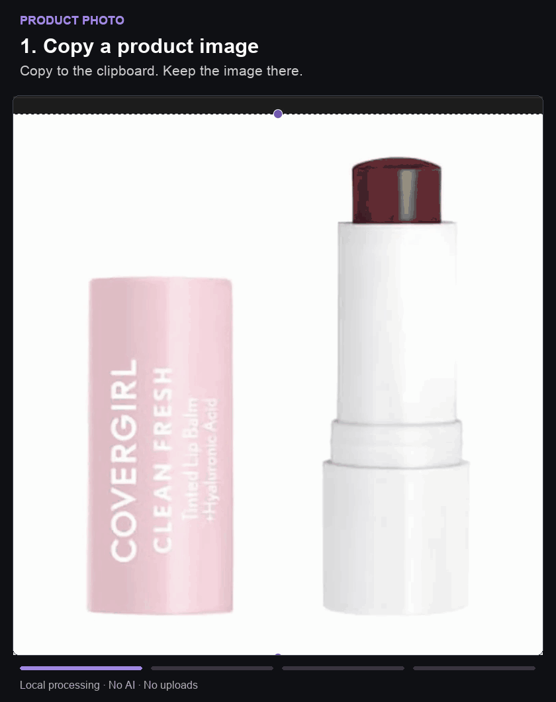

# Product Photo

English | [Chinese](README.zh-CN.md)

**Add a consistent product photo to an Obsidian note in one click.**

Copy an image of a product, open its note, and click **Import product photo**. The plugin saves an optimized local image, displays it in the note, and fills in a `photo` property that Obsidian Bases can use for gallery cards.

Useful for collections and inventories: cosmetics, books, equipment, or anything you keep one note per item for. You create the notes; Product Photo handles their images. All processing stays on your device.



**Early release for macOS desktop.** This plugin is installed manually; it is not listed in Obsidian’s Community plugins directory. The core workflow has been tested on Obsidian 1.13.4 and macOS 26.6.2. Mobile is not supported; Windows and Linux have not been tested.

## Install

You do **not** need Node.js, Python, or a terminal to use the prebuilt plugin.

1. [Download Product Photo 0.1.0](downloads/product-photo-0.1.0.zip?raw=true) and unzip it. You should get a folder named `product-photo`.
2. Open the Obsidian vault where you want to use the plugin. Go to **Settings → Community plugins** and turn on community plugins if prompted.
3. Click the **folder icon** beside **Installed plugins** to open that vault’s plugins folder in Finder.
4. Copy the entire unzipped `product-photo` folder into it. The files must be directly inside that folder, as shown below.
5. Restart Obsidian, return to **Settings → Community plugins**, and enable **Product Photo**.

```text
Your vault/
└── .obsidian/
    └── plugins/
        └── product-photo/
            ├── main.js
            ├── manifest.json
            ├── styles.css
            ├── LICENSE
            └── THIRD_PARTY_NOTICES.md
```

If you cannot open the plugins folder from Settings, open your vault folder in Finder, press **Command + Shift + .** to show hidden files, and open `.obsidian`. Create a `plugins` folder inside it if needed.

Download the plugin ZIP linked above, rather than GitHub’s **Code → Download ZIP**, which contains the source code. To build from source instead, see [Development](docs/DEVELOPMENT.md).

## Set up once

Open **Settings → Product Photo** and use these values to follow the examples in this guide:

| Setting | Value | What it means |
|---|---|---|
| Enabled folder scope | Leave empty | Allow product notes anywhere in this vault. |
| Image folder | `Photos` | Save imported images in this vault folder; it is created when needed. |
| Image property | `photo` | Store the image link in this note property. |
| Photo section heading | `Product photos` | Look for a section with this exact heading. Set this explicitly; do not rely on the initial value. |
| Trim outer white margins | Off | Keep the whole screenshot, including pale packaging. |

Folder paths are relative to your vault, for example `Inventory/Photos`. If you later limit the scope to `Products`, put your product notes inside that folder.

## Import your first photo

### 1. Prepare a product note

Create a normal Markdown note, such as `Berry Lip Balm`. Open the command palette with **Command + P**, find **Product Photo: Add photo import button to current note**, and run it.

The command adds the **Product photos** section and its import control. You can also copy this complete starter note, or use the [example file](examples/Product.md):

````markdown
---
photo: ""
---

## Product photos

```product-photo
```

## Notes
Write your own notes here.
````

Switch to **Reading view** or **Live Preview** to see the button. In Source mode, the `product-photo` block is shown as text. In Live Preview, move the cursor outside the block if you are editing it.

### 2. Copy an image

Capture just one product to the clipboard on macOS with **Control + Shift + Command + 4**, or copy image pixels from an image app. In Preview, **Command + A**, then **Command + C** copies the image. Use **Choose image file** if you already have a PNG, JPEG, or WebP on disk.

The clipboard must contain the image itself. Copying a product page URL or an image address does not download the image.

### 3. Click Import product photo

Return to the product note and click **Import product photo**. Do not paste the screenshot into the note first.

On success:

- A white-background, 800 × 800 WebP appears in the note.
- A file such as `Photos/Berry Lip Balm.webp` is saved in your vault.
- The note’s `photo` property contains `[[Photos/Berry Lip Balm.webp]]`.
- The button changes to **Replace image**. Your other properties and notes stay in place.

**Copy → click Import. No Command-V step.** Normal Obsidian paste inserts a separate original image. Pasting first and then importing can leave two images in the note.

## Replace a photo or reuse the setup

Copy the next image and click **Replace image**, or use **Choose image file**. The plugin updates the product photo link and embed. It keeps the old attachment so other notes that use it continue to work; it never overwrites an existing file. Filename conflicts receive a suffix such as `Berry Lip Balm-2.webp`.

To reuse the button for new products, put the starter note above in your own Obsidian template. No template plugin is required to use Product Photo itself. You may also assign a shortcut to **Product Photo: Import product photo from clipboard** under **Settings → Hotkeys**, after preparing the note’s import section.

## Show photos in a Bases gallery — optional

You can use the plugin without Bases. If you already have a Bases cards view, choose `photo` as its image property and use **Contain** so the complete product is visible.

For a ready-made example, copy [Product gallery.base](examples/Product%20gallery.base) into your vault and open it. It shows Markdown notes that have a `photo` property. To embed that gallery in a dashboard note, add:

```markdown
![[Product gallery.base#Products]]
```

The gallery uses the same local images as your notes. Product Photo does not create or rewrite your existing dashboards.

## Troubleshooting

| Problem | What to check |
|---|---|
| Product Photo is not listed after installation | Check that `main.js` and `manifest.json` are directly inside `.obsidian/plugins/product-photo/`, then restart Obsidian. Avoid an extra nested folder. |
| The button appears as code | Enable the plugin, use Reading view or Live Preview, and move the cursor outside the code block. The block language must be exactly `product-photo`. |
| Import says the photo section is missing | Set **Photo section heading** to match your note heading exactly. For this guide, use `Product photos`. Run the add-button command if needed. |
| The command is missing or the button is disabled | Check **Enabled folder scope**. Leave it empty for this guide, or move the note into the configured folder. |
| “Copy an image or screenshot first” | Copy image pixels, not a URL, or use **Choose image file**. |
| Two images appear | One may be a normal pasted image and the other the plugin’s optimized image. Remove the unwanted embed from the note; the original attachment can remain. On the next import, copy and click the button without pasting. |
| The photo property cannot be updated | It must be text or empty, not a list or another property type. |
| Import stops after you edit the photo section | Retry once editing is complete. The plugin stops rather than overwrite a conflicting photo edit. |
| The input is rejected | Use a static PNG, JPEG, or WebP no larger than 20 MiB and 25 megapixels. |

Imported images stay local and work as ordinary image links even if you disable the plugin. Images are centered without stretching; originals are not uploaded or stored as extra copies by the importer. Old attachments from replacements remain until you decide to remove them.

## Project documentation

- [Product requirements](docs/REQUIREMENTS.md)
- [Development and packaging](docs/DEVELOPMENT.md)
- [Test results and remaining verification](VALIDATION.md)
- [Report a problem](https://github.com/xiaohanglyu/obsidian-product-photo/issues)

## License

[MIT](LICENSE). Bundled dependency licenses are listed in [Third-party notices](THIRD_PARTY_NOTICES.md).
