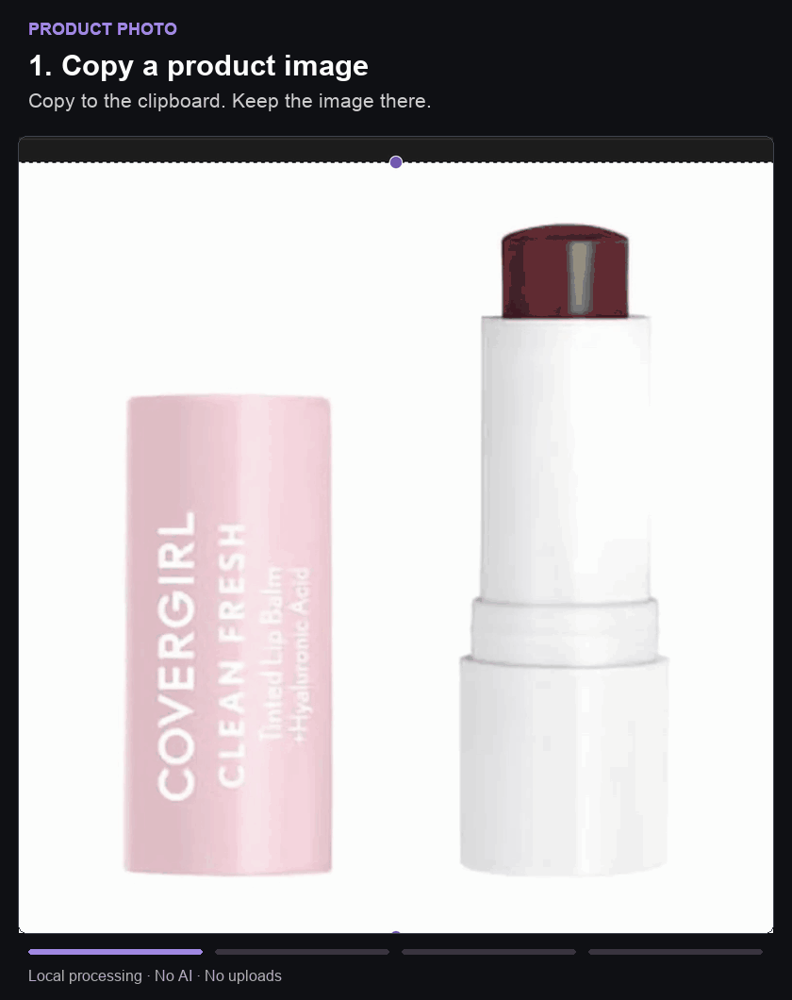

# Product Photo

[English](README.md) | 简体中文

**点击一次，为 Obsidian 产品笔记添加统一规格的图片。**

复制产品图，打开对应笔记，点击 **Import product photo**。插件会将图片优化并保存到本地，在正文显示，同时填写 `photo` 属性，供 Obsidian Bases 图鉴读取。

适合用“一件物品一篇笔记”管理化妆品、书籍、设备或其他收藏。你负责创建笔记，Product Photo 负责处理图片，整个过程在本机完成。



**当前是面向 macOS 桌面的早期版本。** 需要手工安装，尚未上架 Obsidian 社区插件目录。核心流程已在 Obsidian 1.13.4、macOS 26.6.2 上验证。暂不支持移动端，Windows 和 Linux 尚未测试。

## 安装

使用预编译安装包，**不需要 Node.js、Python 或终端**。

1. [下载 Product Photo 0.1.0](downloads/product-photo-0.1.0.zip?raw=true) 并解压，得到名为 `product-photo` 的文件夹。
2. 在 Obsidian 中打开要使用插件的 Vault，进入 **设置 → 第三方插件（Community plugins）**，按提示启用第三方插件。
3. 点击 **已安装插件（Installed plugins）** 旁的文件夹图标，在 Finder 中打开这个 Vault 的插件目录。
4. 将解压后的整个 `product-photo` 文件夹放进去，确保文件层级与下图一致。
5. 重启 Obsidian，回到第三方插件设置，启用 **Product Photo**。

```text
你的 Vault/
└── .obsidian/
    └── plugins/
        └── product-photo/
            ├── main.js
            ├── manifest.json
            ├── styles.css
            ├── LICENSE
            └── THIRD_PARTY_NOTICES.md
```

如果无法从设置中打开插件目录，可以在 Finder 中打开 Vault 文件夹，按 **Command + Shift + .** 显示隐藏文件，进入 `.obsidian`。如果里面没有 `plugins` 文件夹，手工创建即可。

请下载上方链接中的插件安装包。GitHub 的 **Code → Download ZIP** 下载的是源码，不是可直接安装的插件。需要从源码构建时，请阅读 [开发指南](docs/DEVELOPMENT.md)。

## 首次设置

进入 **设置 → Product Photo**，按下面的值配置，即可使用本指南中的示例。设置项名称保留插件中的英文，便于对应查找。

| 设置项 | 填写值 | 作用 |
|---|---|---|
| Enabled folder scope | 留空 | 允许在 Vault 任意位置使用产品笔记。 |
| Image folder | `Photos` | 图片保存目录，不存在时会自动创建。 |
| Image property | `photo` | 保存图片链接的笔记属性名。 |
| Photo section heading | `Product photos` | 定位同名照片章节。请显式填写，不要依赖初始值。 |
| Trim outer white margins | 关闭 | 保留完整截图，避免裁掉浅色包装。 |

目录路径相对于 Vault 根目录，例如 `Inventory/Photos`。如果之后把启用范围设置成 `Products`，产品笔记也需要放进这个文件夹。

## 导入第一张产品图

### 1. 准备产品笔记

创建一篇普通 Markdown 笔记，例如 `Berry Lip Balm`。按 **Command + P** 打开命令面板，找到并执行 **Product Photo: Add photo import button to current note**。

命令会创建 **Product photos** 章节并放入导入按钮。你也可以直接复制下面这份完整笔记，或使用 [示例文件](examples/Product.md)：

````markdown
---
photo: ""
---

## Product photos

```product-photo
```

## Notes
在这里写自己的使用记录。
````

切换到**阅读模式**或**实时预览（Live Preview）**就能看到按钮。源码模式会显示 `product-photo` 代码块文本；实时预览中如果正在编辑代码块，将光标移到块外即可。

你也可以把章节标题改成“产品照片”，同时将插件的 **Photo section heading** 改成完全相同的文字。代码块中的 `product-photo` 不要翻译。

### 2. 复制图片

在 macOS 按 **Control + Shift + Command + 4**，框选单个产品，截图会进入剪贴板。也可以从图片应用复制图片，例如在“预览”中按 **Command + A**，再按 **Command + C**。已有 PNG、JPEG 或 WebP 文件时，可直接使用 **Choose image file**。

剪贴板里需要是图片本身。复制商品页面链接或图片网址，不会自动下载图片。

### 3. 点击 Import product photo

回到产品笔记，点击 **Import product photo**，不要先把截图粘贴进正文。

成功后：

- 正文显示一张白底、800 × 800 的 WebP 图片。
- 图片保存为类似 `Photos/Berry Lip Balm.webp` 的本地文件。
- `photo` 属性填入 `[[Photos/Berry Lip Balm.webp]]`。
- 按钮变为 **Replace image**，其他属性和记录保留。

**复制 → 点导入，不需要 Command-V。** 普通 Obsidian 粘贴会插入另一张原图；先粘贴再导入，正文可能显示两张图片。

## 替换图片与复用模板

复制下一张图片，再点击 **Replace image**，或点击 **Choose image file**。插件会更新产品图的属性和正文引用，同时保留旧附件，避免影响其他笔记。已有文件不会被覆盖，同名时会使用 `Berry Lip Balm-2.webp` 这样的后缀。

想为每个新产品复用按钮，可以把前面的示例笔记放进自己的 Obsidian 模板。Product Photo 本身不依赖模板插件。准备好导入章节后，也可以在 **设置 → 快捷键** 中为 **Product Photo: Import product photo from clipboard** 绑定按键。

## 在 Bases 图鉴中显示图片（可选）

不使用 Bases 也可以正常导入图片。如果已有 Bases 卡片视图，将图片属性设置为 `photo`，图片适配选择 **Contain（完整显示）** 即可。

也可以把 [Product gallery.base](examples/Product%20gallery.base) 复制到 Vault 中打开。它会显示带有 `photo` 属性的 Markdown 笔记。需要在 Dashboard 中嵌入时，添加：

```markdown
![[Product gallery.base#Products]]
```

图鉴和笔记读取同一张本地图片。Product Photo 不会自动创建或改写你已有的 Dashboard。

## 常见问题

| 问题 | 检查方法 |
|---|---|
| 安装后找不到 Product Photo | 确认 `main.js` 和 `manifest.json` 直接放在 `.obsidian/plugins/product-photo/` 内，避免多套一层目录，然后重启 Obsidian。 |
| 按钮显示成代码 | 确认插件已启用，使用阅读模式或实时预览，将光标移出代码块。代码块语言必须是 `product-photo`。 |
| 提示缺少照片章节 | **Photo section heading** 必须与笔记章节标题完全一致。本指南使用 `Product photos`；必要时重新运行添加按钮命令。 |
| 找不到命令或按钮不可点 | 检查 **Enabled folder scope**。按本指南操作时留空，或把笔记移动到配置的目录内。 |
| 提示 “Copy an image or screenshot first” | 复制图片像素，而不是网址；也可以点击 **Choose image file**。 |
| 出现两张图片 | 可能先进行了普通粘贴，之后又通过插件导入。移除正文中不需要的嵌入即可，原附件可以保留。下次复制后直接点按钮。 |
| 无法更新图片属性 | 该属性应为文本或空值，不能是列表或其他类型。 |
| 编辑照片章节后导入停止 | 编辑完成后重试。插件遇到照片区域冲突会停止，避免覆盖你的修改。 |
| 图片输入被拒绝 | 使用不超过 20 MiB、2500 万像素的静态 PNG、JPEG 或 WebP。 |

图片始终保存在本地，停用插件后仍是可用的普通图片链接。产品图保持比例并居中，不会拉伸；导入器不会上传图片或额外保存原图副本。替换产生的旧附件会保留，由你决定何时删除。

## 项目文档

- [产品需求（英文）](docs/REQUIREMENTS.md)
- [开发与打包指南（英文）](docs/DEVELOPMENT.md)
- [测试结果与待验证项目（英文）](VALIDATION.md)
- [报告问题](https://github.com/xiaohanglyu/obsidian-product-photo/issues)

## 许可证

[MIT](LICENSE)。打包依赖的许可证见 [第三方声明](THIRD_PARTY_NOTICES.md)。
